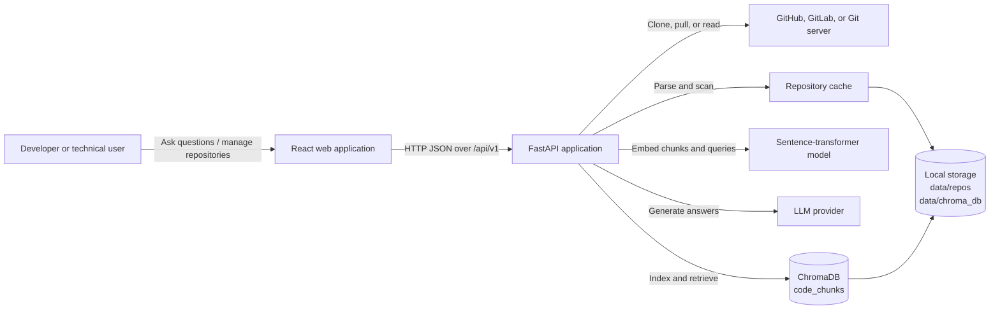
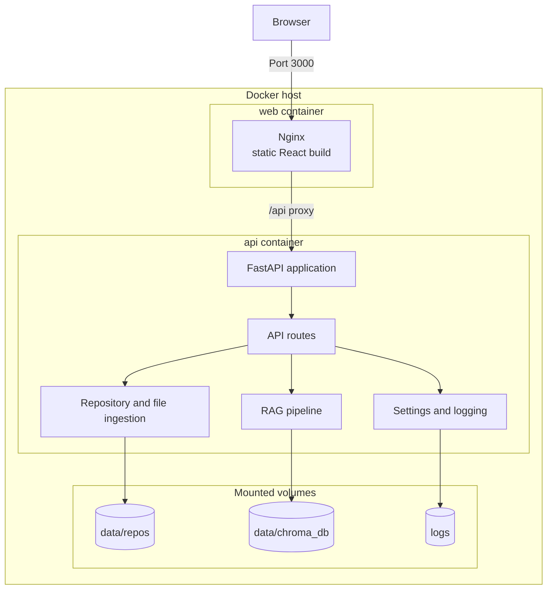
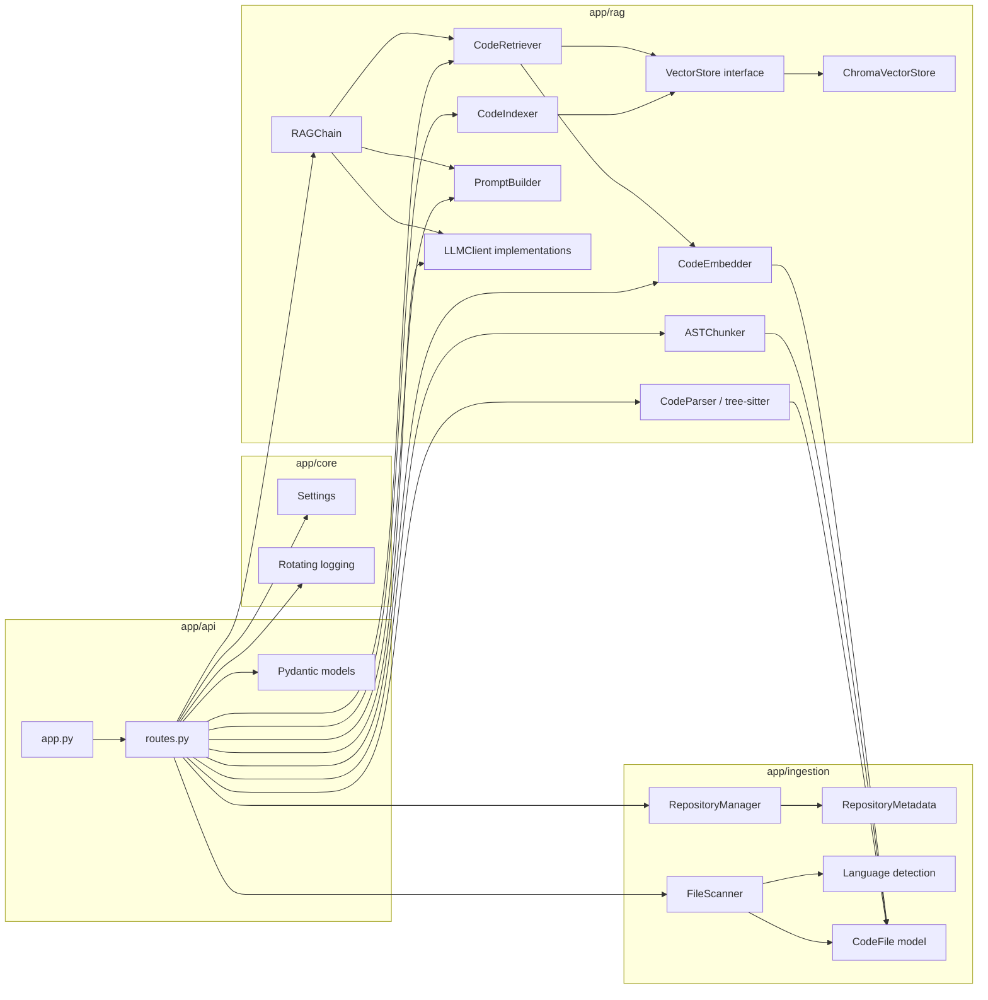
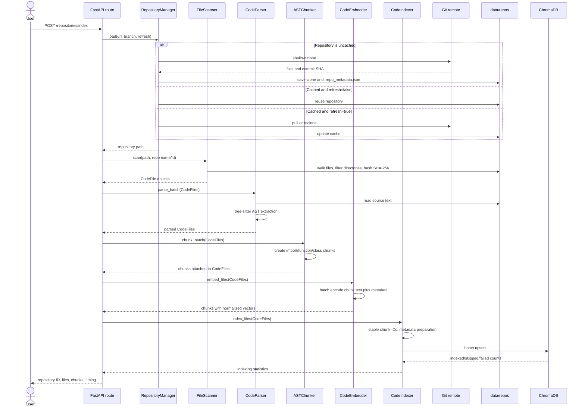
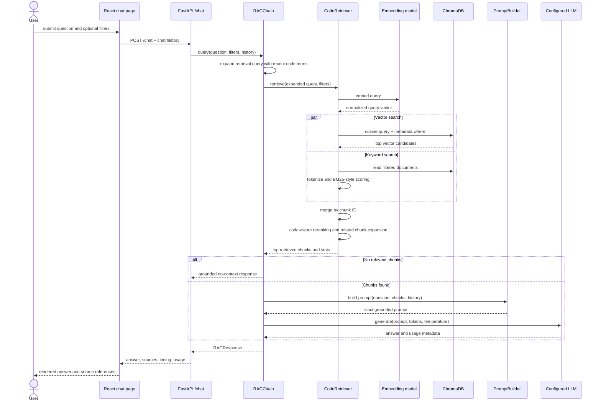
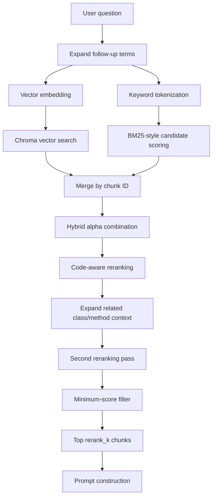
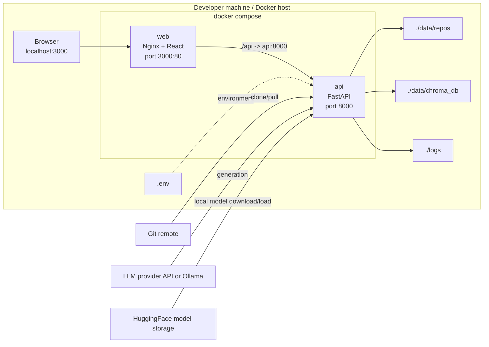
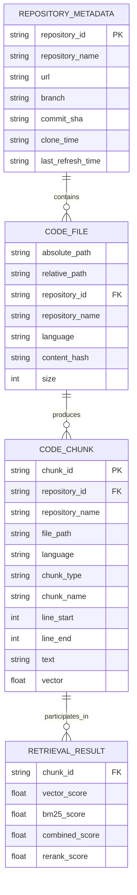

# Code Q&A Assistant — System Design

## 1. Purpose and Scope

The Code Q&A Assistant is a retrieval-augmented generation (RAG) system for answering questions about one or more Git repositories. It:

- clones or caches Git repositories;
- scans supported source files;
- parses code into AST-aware semantic units;
- embeds and persists code chunks in ChromaDB;
- performs metadata-filtered, hybrid vector and keyword retrieval;
- constructs a grounded prompt with conversation memory;
- generates a cited answer with a configurable HuggingFace, Groq, OpenAI, or Ollama client.

The implementation is a two-service Docker deployment: a React/Nginx frontend and a FastAPI backend. ChromaDB and cached repositories are local persistent volumes.

## 2. System Context



## 3. Container Architecture



The frontend container does not perform business logic. Nginx serves `frontend/dist` and proxies `/api` to the `api:8000` Docker service.

## 4. High-Level Component Diagram



## 5. Indexing Pipeline



### Progressive enrichment

The central indexing data model is `CodeFile`. The same object is progressively enriched:

```text
CodeFile
  + absolute/relative path
  + repository_id/name
  + language and SHA-256 content hash
  -> AST and extracted imports/functions/classes/docstrings
  -> semantic CodeChunk objects
  -> embedding vectors
  -> persisted Chroma documents
```

Stable chunk IDs use repository ID, file path, chunk type, name, and start line. Chunks are skipped when that ID already exists.

## 6. Query Pipeline



The frontend sends the previous six turns as conversation memory. `RAGChain` uses them to make an expanded deterministic retrieval query and `PromptBuilder` includes them only as conversational context, not as code evidence.

## 7. Retrieval and Reranking Design



Retrieval uses repository, language, file, and chunk metadata. Code-aware reranking adds identifier overlap, exact identifier matches, chunk-type boosts, constructor/method intent, source-file preference over tests, and docstring boosts.

## 8. Deployment View



Ports:

| Component | Host port | Container port |
|---|---:|---:|
| Frontend / Nginx | 3000 | 80 |
| Backend / FastAPI | 8000 | 8000 |

Docker volumes map `./data` and `./logs` into the API container. The persistent vector database and cloned repositories survive container restarts.

## 9. API Surface

| Method | Path | Responsibility |
|---|---|---|
| `GET /` | API metadata | Basic service description |
| `GET /health` | `/health` | Service liveness |
| `GET /api/v1/health` | Health detail | Chroma, embedding model, and configured LLM status |
| `POST /api/v1/repositories/index` | Repository indexing | Clone/cache, scan, parse, chunk, embed, and index |
| `GET /api/v1/repositories` | Repository inventory | Read cached repository metadata |
| `DELETE /api/v1/repositories/{repository_id}` | Repository deletion | Remove vectors and cached repository |
| `POST /api/v1/chat` | Code Q&A | Hybrid retrieval, prompt, and generation |

FastAPI also exposes interactive API documentation at `/docs` and `/redoc`.

## 10. Data Model



Repository metadata is stored as `.repo_metadata.json` under each cached repository directory. ChromaDB stores chunk text, vectors, and filterable metadata.

## 11. Configuration

Important configuration groups:

- **LLM:** provider, model, token, device, and Ollama URL.
- **Embeddings:** model, batch size, dimensions, normalization, and device.
- **Retrieval:** initial candidate count, rerank count, hybrid alpha, minimum score, and reranking toggle.
- **Prompt:** included line numbers/types, maximum chunks, and instruction style.
- **ChromaDB:** persistent directory, collection name, and distance metric.
- **Repository storage:** cache directory, GitHub token, and hash algorithm.
- **Scanning:** supported extensions and ignored directories/files.
- **Operations:** API host/port, log directory, log size, and backup count.

Secrets must remain in `.env` or deployment environment variables and must not be embedded in repository URLs or source logs.

## 12. Reliability and Failure Behavior

- Invalid or inaccessible repository sources return an indexing HTTP 500 through the route's error handling.
- No code files found returns HTTP 400.
- Repository deletion validates that the target path remains inside the configured cache directory.
- Pull failures attempt a clean repository refresh/reclone path.
- Vector, embedding, and LLM health are reported separately.
- A query with no retrieved chunks returns a no-context answer without calling the LLM.
- Component exceptions are logged and surfaced at API boundaries.

## 13. Security and Operational Boundaries

The current implementation has no authentication, authorization, per-user isolation, or rate limiting. CORS currently allows every origin. For production use, the design should add:

- authentication and authorization;
- strict CORS allowlists;
- repository URL validation and SSRF controls;
- request size and timeout limits;
- asynchronous or queued indexing for large repositories;
- encrypted or managed secret storage;
- TLS termination;
- audit logs and tenant-scoped collections or metadata.

Repository cloning uses Git credential helpers or an environment-provided token rather than placing the token in the Git URL.

## 14. Scalability and Evolution

The implementation is suitable for a local or small-team deployment but is not horizontally scalable in its current form:

- ChromaDB is on local persistent storage.
- Repository caches and metadata are local filesystem state.
- FastAPI creates pipeline components per route request.
- HuggingFace models may be loaded into process memory repeatedly.
- Indexing and querying are synchronous HTTP operations.
- Chat history is client-provided; no server-side session database exists.

Recommended evolution:

1. add a job queue and worker pool for indexing;
2. persist repository records and index jobs in PostgreSQL;
3. use a managed or distributed vector database;
4. cache embedding models and provider clients in long-lived workers;
5. use streaming responses for chat;
6. add incremental file diffing instead of stable-ID skipping alone;
7. add authentication and tenant-aware retrieval filters;
8. add parser implementations for JavaScript, Java, Go, Rust, and other declared languages.

## 15. Current Implementation Notes

These points distinguish the implemented system from aspirational features:

- JavaScript, Java, Go, and Rust parser branches are currently placeholders; unsupported extraction falls back to text chunking.
- The retriever has structure-aware reranking and related-context expansion.
- Repository index metadata tracks files and chunks, but full-file and chunk status is not stored in a separate database.
- Incremental indexing primarily skips existing stable chunk IDs; deleted or changed old chunks are not globally reconciled during re-indexing.
- LLM, embedding, and Ollama integrations are provider abstractions, but no provider is abstracted for the vector store interface beyond ChromaDB.
- The UI supports repository selection, language filtering, source citations, chat memory, and health/repository pages.
